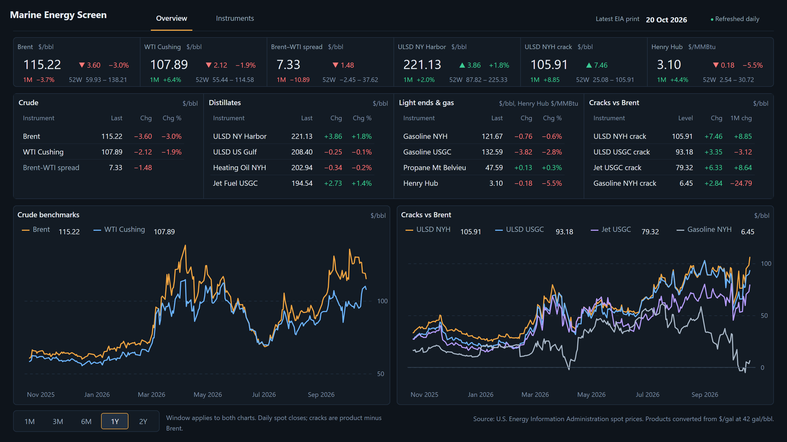
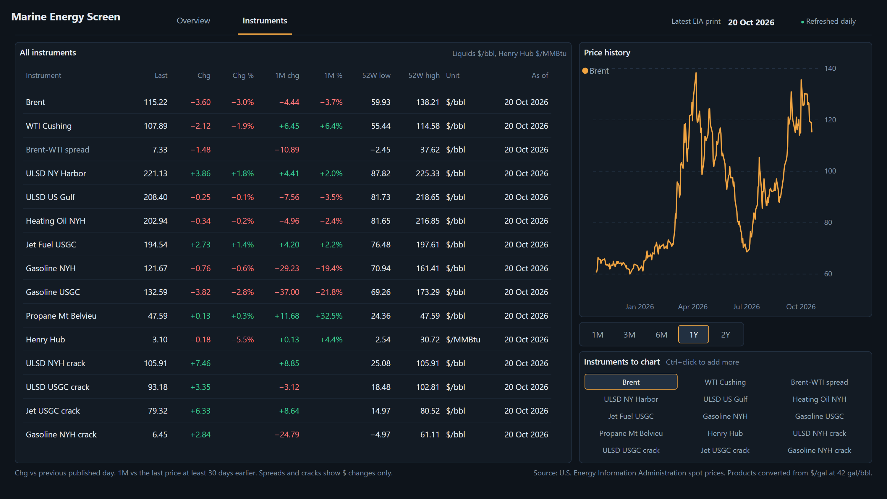

# Marine Energy Screen

**Your own private energy-market screen in Power BI**, built on the free [U.S. Energy Information Administration (EIA) Open Data API](https://www.eia.gov/opendata/). Crude, refined products, natural gas, spreads and cracks, refreshed automatically every day, with no manually maintained data and no Power BI Desktop required.

It is also a **template**. The whole report is stored as plain text (Power BI's PBIP format), so an AI assistant can read it and adapt it to another data source you have API access to, such as freight indices or bunker prices. See [Build your own screen](#build-your-own-screen-with-ai).




## What you get

| Page | Shows |
|---|---|
| **Overview** | Benchmark strip (Brent, WTI Cushing, Brent–WTI spread, ULSD NY Harbor, ULSD NYH crack, Henry Hub) with daily move, 1-month move and 52-week range; four price boards (Crude, Distillates, Light ends & gas, Cracks vs Brent); crude and crack history charts with a 1M / 3M / 6M / 1Y / 2Y window |
| **Instruments** | Every instrument with last price, daily and 1-month changes, 52-week low/high and as-of date; history chart for any combination of instruments |

Both pages have phone layouts for the Power BI mobile app.

> **About "daily" refresh.** The report's data model refreshes every day, but EIA publishes these spot prices in **weekly batches** (usually on Wednesdays). Between releases the figures stay the same even though the refresh succeeded. The header shows both dates so you can tell which is which:
> - **Latest EIA print**: the date of the newest price EIA has published
> - **Refreshed … UTC**: when the report last fetched data

## Quick start

1. Get a free EIA API key (step 1).
2. Set up Python once (step 2: commands differ on macOS and Windows).
3. Run the deploy script (step 3).
4. In Power BI Service, set the connection to Anonymous, refresh, and schedule a daily refresh (step 4).

### 1. Get an EIA API key

Register at https://www.eia.gov/opendata/ with your email address; the key arrives by email within a few minutes. It is free and read-only.

### 2. Set up Python (once)

You need **Python 3.9 or later** and **Git** (or GitHub Desktop) to download this repository.

**macOS (Terminal)**

```bash
git clone https://github.com/dmousouroulis/marine-energy-screen.git
cd marine-energy-screen
python3 -m venv .venv
source .venv/bin/activate
pip install azure-identity requests
```

If you installed Python with Homebrew, the virtual environment (`.venv`) is required: Homebrew's Python refuses `pip install` outside one, with an "externally-managed-environment" error.

**Windows (PowerShell)**

```powershell
git clone https://github.com/dmousouroulis/marine-energy-screen.git
cd marine-energy-screen
py -m venv .venv
.venv\Scripts\Activate.ps1
pip install azure-identity requests
```

If PowerShell blocks the activation script, run `Set-ExecutionPolicy -Scope CurrentUser RemoteSigned` once, or use Command Prompt instead: `.venv\Scripts\activate.bat`.

In a new terminal window later, go back to the folder and activate the environment again (`source .venv/bin/activate` on macOS, `.venv\Scripts\Activate.ps1` on Windows) before running the script.

### 3. Deploy to Power BI

The command is the same on both systems (use `python3` on macOS if `python` is not found):

```bash
python scripts/deploy_to_powerbi.py --workspace "My workspace" --eia-key YOUR_EIA_KEY
```

A browser window opens for you to sign in to Power BI. The script then creates the semantic model and the report through the Fabric REST API and prints links to both. Running it again later updates both in place; pass `--eia-key` each time.

`--workspace` takes the exact workspace name. A free Power BI licence can publish to **My workspace**; sharing with others needs Pro or Premium Per User.

### 4. Connect and schedule (Power BI Service)

Open the semantic model's **Settings** (link printed by the script, or *My workspace → MarineEnergyScreen semantic model → ⋯ → Settings*):

1. **Data source credentials → Edit credentials** for `api.eia.gov`: Authentication method **Anonymous**, privacy level **Organizational**, tick **Skip test connection**, then **Sign in**.
2. Go back to the workspace and click **Refresh now** on the semantic model.
3. Under **Refresh**, turn on a **daily scheduled refresh** and tick failure notifications.

Open the report, and on your phone use the Power BI app in portrait to get the phone layout.

### Alternative: Power BI Desktop (Windows only)

Power BI Desktop does not run on macOS. On Windows you can instead open `MarineEnergyScreen.pbip`, set the `EiaApiKey` parameter under *Transform data → Edit parameters*, refresh, and publish. This route is untested; the script above is the tested path.

### Alternative: Fabric Git integration

A workspace on Fabric, Premium or Premium Per User capacity can connect directly to a fork of this repository; the `.SemanticModel` and `.Report` folders sync as items. Set the `EiaApiKey` parameter in the semantic model settings, then follow step 4.

## Instruments and units

| Group | Instruments | EIA series |
|---|---|---|
| Crude | Brent, WTI Cushing | `RBRTE`, `RWTC` |
| Distillates | ULSD NY Harbor, ULSD US Gulf, Heating Oil NYH, Jet Fuel USGC | `EER_EPD2DXL0_PF4_Y35NY_DPG`, `EER_EPD2DXL0_PF4_RGC_DPG`, `EER_EPD2F_PF4_Y35NY_DPG`, `EER_EPJK_PF4_RGC_DPG` |
| Light ends & gas | Gasoline NYH, Gasoline USGC, Propane Mt Belvieu, Henry Hub | `EER_EPMRU_PF4_Y35NY_DPG`, `EER_EPMRU_PF4_RGC_DPG`, `EER_EPLLPA_PF4_Y44MB_DPG`, `RNGWHHD` |
| Calculated | Brent–WTI spread; ULSD NYH, ULSD USGC, Jet USGC and Gasoline NYH cracks vs Brent | derived per day in Power Query |

- Liquids are in $/bbl: EIA publishes products in $/gal and the query multiplies by 42. Henry Hub is in $/MMBtu.
- Spreads and cracks show dollar changes only; percentage changes are not meaningful for them.
- Change is against the previous published day; 1M is against the last price at least 30 days earlier.

## Compatibility and testing

| Component | Verified environment |
|---|---|
| Power BI Service | Free licence, My workspace, October 2026 |
| Power BI mobile | iPhone app, portrait phone layout |
| Deploy script | macOS (Apple Silicon), Python 3.14 via Homebrew |
| Windows deploy | Commands documented above, not yet tested |
| Power BI Desktop | Not tested |

## Troubleshooting

- **The numbers haven't changed for days.** Usually normal: compare *Latest EIA print* with *Refreshed … UTC* in the header. If the refresh time is current, EIA simply hasn't published a new batch yet.
- **"Failed to update data source credentials" or a 400 error when saving credentials.** Tick **Skip test connection**. The test call goes to `https://api.eia.gov/` without a key, which EIA rejects even though the real refresh works.
- **No "Key" authentication option.** Expected: the key travels as a model parameter, so choose **Anonymous**.
- **`can't open file … deploy_to_powerbi.py`.** Run the command from inside the repository folder.
- **`externally-managed-environment` on macOS.** Create and activate the `.venv` as in step 2.
- **The chart window isn't the default 1Y.** Power BI remembers your last selection; use **Reset to default** in the report toolbar.
- **Refreshes take 10–15 minutes overnight but seconds on demand.** Normal on shared capacity: scheduled refreshes queue before they start.

## How it works

| Step | Where |
|---|---|
| Fetch daily spot prices from EIA API v2, page through results, convert $/gal to $/bbl | Power Query: `Prices` table |
| Calculate spreads and cracks per day (product minus Brent) | Power Query: `Prices` table |
| Instrument names, groups, units and display order | Power Query: `Series` table |
| Last price, changes, 52-week range, chart windows | DAX measures: `_Measures` table |
| Pages, visuals, phone layouts | `MarineEnergyScreen.Report/definition/pages/` |
| Colours, fonts and visual defaults | `MarineEnergyScreen.Report/StaticResources/RegisteredResources/MarineEnergyDark.json` |

Customising this EIA screen:

- **History length**: the `HistoryDays` parameter (default 730 days).
- **Add an EIA instrument**: add its series ID to `Config` in the `Prices` query and a matching row in the `Series` query (both in `MarineEnergyScreen.SemanticModel/definition/tables/`).

## Build your own screen with AI

This project was built with an AI assistant (Claude by Anthropic), which wrote the semantic model and the report from a description of the data and a mock-up. Because a PBIP project is plain text, you can do the same for **any market data you have API access to**: for example freight indices, broker FFA screens, or VLSFO and other bunker prices.

You need three things:

1. **An API key and its documentation**: the endpoint URL, how the key is passed (header or query parameter), and a sample response.
2. **Your licence terms.** Commercial feeds such as Baltic Exchange data, broker screens and bunker price services are licensed, and usually forbid redistribution. Keep your screen private, never commit keys or data to a public repository, and check that your licence allows automated API access.
3. **This repository** as the starting point, so the assistant keeps the structure, deployment script, layout and design.

### Starter prompt

Copy this into an AI assistant along with this repository (or its key files) and your API documentation, then fill in the brackets:

```text
I want to adapt the Marine Energy Screen Power BI project (PBIP: TMDL semantic model + PBIR report)
to a different data source. Keep the folder structure, the deploy script, the page layout and the
design system; change only what the new data requires.

Data source
- Provider and API: [e.g. bunker price API, freight index API]
- Endpoint and authentication: [URL; key in header "X-API-Key" / query parameter "apikey"]
- Sample response: [paste a short JSON sample]
- Update frequency: [e.g. daily after 17:00 London; weekly]

Instruments
- [Name, code in the API, unit, group]  e.g. "VLSFO Singapore, SIN-VLSFO, $/mt, Bunkers"
- Calculated series: [e.g. "VLSFO–HSFO spread Singapore = VLSFO minus HSFO"]

Screen
- Ticker strip benchmarks: [up to six instruments]
- Boards: [up to four groups]
- Charts: [two charts and which instruments each shows]
- Percentage changes: show for outright prices, not for spreads.

Requirements
- Pass the key as a model parameter, never stored in the files.
- Keep Web.Contents with a fixed base URL plus RelativePath/Query so scheduled refresh works in Power BI Service.
- Keep the phone layouts and validate every JSON file against Microsoft's published PBIR schemas.
- Do not invent instrument codes or units; ask me if something is unclear.
```

Work in small steps: get the data loading and one board right first, deploy, check the numbers against your provider, then add the rest.

### Design rules worth keeping

The layout was designed as a trading screen, and these rules carry over to any market:

- **Headline first:** a ticker strip with up to six benchmarks, then grouped boards, then history charts.
- **Colour has one job each:** green and red only for price moves (always with a + or − sign), one accent colour for the lead series and the selected control, neutral colours for every other chart line.
- **Numbers line up:** right-aligned, fixed decimals, a true minus sign, units in the board header rather than in every cell.
- **Spreads are not prices:** show dollar changes, not percentages.
- **Two dates in the header:** when the data was published and when the report last refreshed.
- **Phone layout from the start:** tiles two across, boards stacked, legends above charts.

Reuse `MarineEnergyDark.json` as the theme to keep the same look.

## Project layout

```
MarineEnergyScreen.pbip                 Power BI project file
MarineEnergyScreen.SemanticModel/       data model in TMDL (queries, measures, relationships)
MarineEnergyScreen.Report/              report in PBIR (pages, visuals, phone layouts, theme)
scripts/deploy_to_powerbi.py            deploy without Power BI Desktop (macOS and Windows)
docs/                                   screenshots
```

## Privacy and security

- Your EIA key is written only into the deployed model's `EiaApiKey` parameter in your own workspace, never into these files. Anyone with edit access to that semantic model can see it.
- The deploy script signs in with your own Microsoft account in the browser; it stores no credentials.
- Data flows only between EIA and your Power BI workspace.

## Data and attribution

Prices come from the U.S. Energy Information Administration Open Data API. EIA data is public domain; please cite EIA as the source. This project is not affiliated with or endorsed by EIA, Microsoft or any data provider mentioned above, and the report is for information only, not trading advice.

## License

[MIT](LICENSE)
